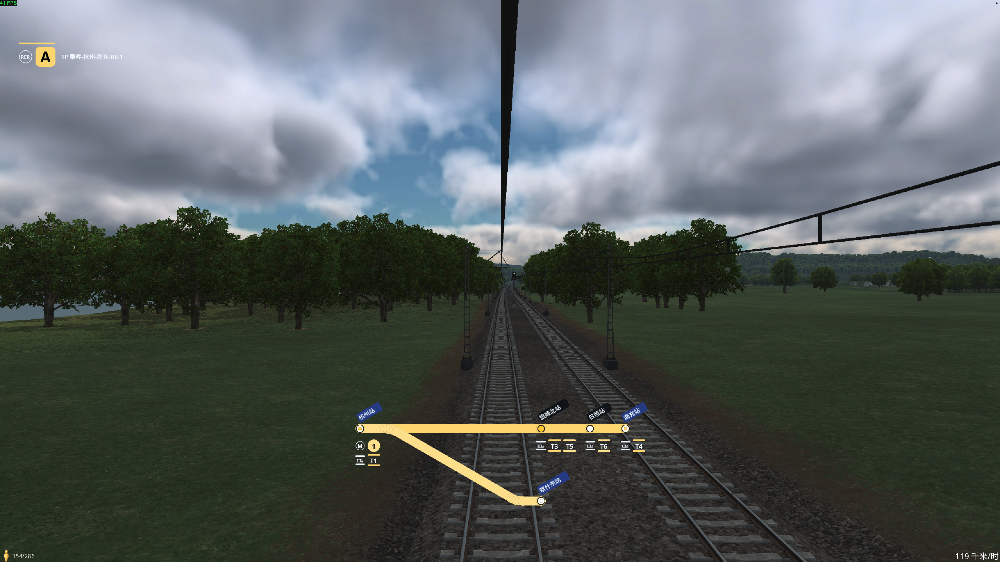
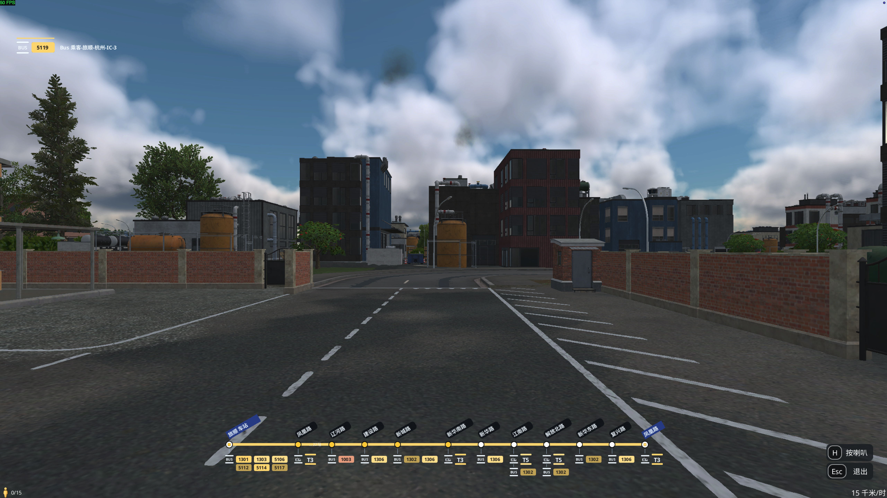

# 游戏线路显示 · 0.1.79dev

[English guide](README.en.md) · 中文


AI 生成的宣传封面；实际游戏效果见下方截图。

在《Transport Fever 3》游戏内显示车辆线路、站点进度和换乘信息，提供第一人称动态线路图与可点击的线路目录。

**开发预发布版。** 当前实现针对 macOS 游戏 Build 40420；Windows／Linux 尚未实测。0.1.61dev 修复了隔离测试中确认的全局样式开销，用户已确认游戏内修改效果满意。长时间内存占用和 C++ 界面释放仍需定时对照，Lua 回归检查不能代替实机测量。

## 游戏内截图

铁路分叉线路（拆分 Train／RER 前的截图）：左上角显示线路标识，下方展示当前行程、支线和换乘。



公交线路：展示较长站序，以及公交、电车等换乘标识。



这两张为用户提供的原始 5120×2880 游戏截图，未经 AI 修改；点击图片可查看原图。

## 下载与安装

已发布安装包见 [Releases](https://github.com/Languisher/tf3-bulb-cockpit/releases)。开发版本可从源码安装，或用 `python3 tools/package.py` 打包。

1. 完整退出游戏。
2. 解压，将 `linnan_bulb_cockpit` 文件夹放入游戏用户目录的 `local/mods/`。
3. 加载存档时启用「游戏线路显示」（英文名称：In-Game Route Display）。
4. 进入有线路的车辆第一人称视角。线路标识在左上角，站点图在底部中央。

macOS Steam 用户目录通常为：

```text
~/Library/Application Support/Steam/userdata/<Steam 用户编号>/3493540/local/mods/
```

从源码安装也可以在仓库根目录运行：

```sh
python3 install.py
```

此脚本仅自动识别本机 macOS Steam 目录；找到多个游戏用户目录时会停止，需手动复制 `mod/` 为 `linnan_bulb_cockpit`。覆盖本模组前会备份到 `previous-install-backups/`，不操作存档。升级后需完整重启游戏。

## 界面语言

目录首页提供语言选择器，支持 **English、简体中文、繁體中文、Français、Deutsch、Español、Italiano、Português (Brasil)、Русский、Polski、Türkçe、Українська、日本語、한국어** 共 14 种语言。默认英文，旧存档中的中英文偏好继续保留；选择后窗口标题、入口提示及界面内容立即切换，保存游戏后保留选择。游戏线路名、站名、城市名和自定义编号保持原文。

翻译按选择加载，缺失词条回退到英文，不增加后台轮询或地图查询。新增语言与翻译维护见 [i18n 说明](docs/I18N.md)。

## 功能

- 铁路默认 **Train**，使用正面火车图标与 A、B、C… 编号；**RER** 是独立的可选类型，默认没有自动归入的线路，使用带 RER 字样的圆角方框图标。旧自动铁路编号保留，手动 RER 选择继续保留。

- 自动读取当前车辆线路、站序、起终点与相关换乘，沿用游戏设置的线路颜色。
- Train、RER、Metro、电车、公交等采用不同线宽、站点和编号样式；铁路与电车可以手动选择显示类型。
- 尚未到达且当前车辆会经过的站常亮黄灯；开启闪烁后只有下一站闪烁，其余未到站继续常亮。已经过、跳过及其他分支不经过的站不亮。在「线路设置」子页面可开启黄灯闪烁，开启可能降低性能。
- 合并线路中，当前车辆不会经过的另一分支站点内部显示白色，不参与黄灯进度与闪烁。
- 每条线路可配置「前缀＋数字／字母编号＋后缀」，支持按最终标号搜索、自然排序及全部应用。仅影响模组标号，不修改游戏真实线路名称。
- 同显示类型、同完整标号的线路可按实际共同起终点合并，显示 fork／parallel branches；整组必须连通。
- 分叉／汇合采用相切圆弧和圆头端点，线条边缘柔化；共用静态遮罩，游戏运行时不生成图片。
- 线路目录按 Train、RER、Metro、Tramway、公交排列；点击编号查看静态线路图，点击换乘编号跳转。公交初始为空，输入搜索后显示匹配结果；返回目录释放当前图的数据。
- 线路图设置入口默认在右上角，与图层按钮同一行、同样大小；按住图标上沿的短横条可拖动，点击主体打开设置。普通地图视角显示，第一人称和暂停菜单中隐藏。
- 静态线路图顶部的图钉可定位地图上的当前线路，关闭设置并释放静态图；第一人称中会先退出驾驶视角。合并图定位当前打开的实际成员。
- 地图上依次点击两个站点，可手动关联为换乘站组；此关联只影响换乘，不作为合并线路的共同端点。
- 「线路设置」子页面的「公交线路编号一键配置」按钮可打开城市／Express 前缀表；批量编号默认关闭，使用数字前缀加至少两位流水号，例如 `10 → 1001`、`51 → 5101`。

在线路设置中，可使用游戏原生的公路、电车、铁路、船舶、航空图标多选筛选，未选中任何图标时显示全部；筛选依据实际运输方式，Train／RER／Metro 显示类型不改变所属筛选类别。搜索和筛选可以叠加，隐藏的编辑仍由「全部应用」保存。

「线路图缩放」滑杆位于载具类型筛选图标上方，默认 **100%**，范围 **10%–400%**，每步 **1%**，可恢复默认。只调整第一人称底部线路图，左上角标识不变；拖动松开后保存，保存游戏后保留偏好。分支图仍按屏幕高度限制缩放以保持可见。缩放直接调整轨道、站点及换乘的原生尺寸与坐标，站名和编号按最终字号重新渲染，避免整图放大造成的文字模糊和分支长度错位。法语等较长的返回文字按内容调整按钮宽度，窄窗口省略时可悬停查看全文。

## 更新与读取范围

每次载入游戏完成一次界面尺寸校准；两个入口共用成功结果，启动重试有上限，完成后卸载校准控件。之后进入第一人称、打开设置和行驶期间都不重新测量。修改分辨率、窗口大小或 UI 缩放后需重新载入存档以校准。

进入第一人称时初始化当前线路、已配置的同号成员和实际相关换乘。行驶中每半秒检查当前车辆状态，进度未变化时不重建图，到站或折返时更新行程；闪烁开启时只更新下一站的小型组件。

重复的同车相机通知不会重置 HUD；配置只在初始化、主动打开设置及确认保存后读取，不随到站检查轮询。第一人称中隐藏整个入口小窗口；退出第一人称会卸载 HUD、释放会话缓存。打开完整设置／目录时会按需读取线路清单。外部修改游戏站序、站名或颜色后，退出并重新进入第一人称刷新。

## 开发

需要 Python 3 和 Lua 5.4；如安装了 `luac`，测试脚本还会检查语法。

```sh
python3 tools/run_tests.py
python3 tools/package.py
```

第一条命令运行独立测试，明确跳过五项需要游戏原版 GUI 文件的集成检查。完整检查方式与手工验收场景见 [测试说明](docs/TESTING.md)。生成的安装包与 SHA-256 校验文件位于 `dist/`。

发布版本以 [VERSION](VERSION) 为准，当前开发版本为 `0.1.79dev`，游戏数值 revision 为 `79`。开发后缀按本项目命名习惯保留为 `dev`。

## 线路图按钮没有显示

按钮只在载入存档后的普通地图视角显示；第一人称、暂停菜单和游戏主菜单中没有此入口。请确认当前存档已启用模组，更新后完整重启游戏。

0.1.79dev 通过官方 `ModEntryPointExtension` 挂载独立的原生浮动窗口，默认位于右上角，可拖动；不再占用图层和时钟旁的工具栏。更早版本的入口依赖 `FreeCamOptions`，其他 UI 模组替换同一组件时可能让入口消失；新版入口保持独立挂载。第一人称 HUD 仍使用相机组件适配，不能据此保证所有 UI 模组都兼容。

若新版在普通地图视角仍没有按钮，请反馈系统、游戏 Build、模组版本、其他 UI 模组，以及启动日志中 `linnan_bulb_cockpit` 附近的错误。日志保留详细消息时，`[Route Display 0.1.79dev] floating entry mounted` 表示入口已提交给原生窗口管理器；只有 installed 消息不能证明按钮挂载成功。

## 素材与归属

本项目受 BULB 的排版启发，与 BULB、RATP、Île-de-France Mobilités 及游戏开发商无隶属或背书关系。Train 类型标识使用 BULB 的 Transilien 正面火车图标；RER 使用独立文字标识，线路编号仍保留 A/B/C 等格式。RER A–E 和火车图形的来源与归属见 [素材说明](mod/content/gui/bulb_cockpit/symbols/notice.md)。不包含 Parisine 商业字体、游戏原版脚本或游戏字体，文字使用游戏原生语言字体。

问题反馈请附版本号、游戏 Build、复现步骤，以及去除个人信息后的相关错误片段。
